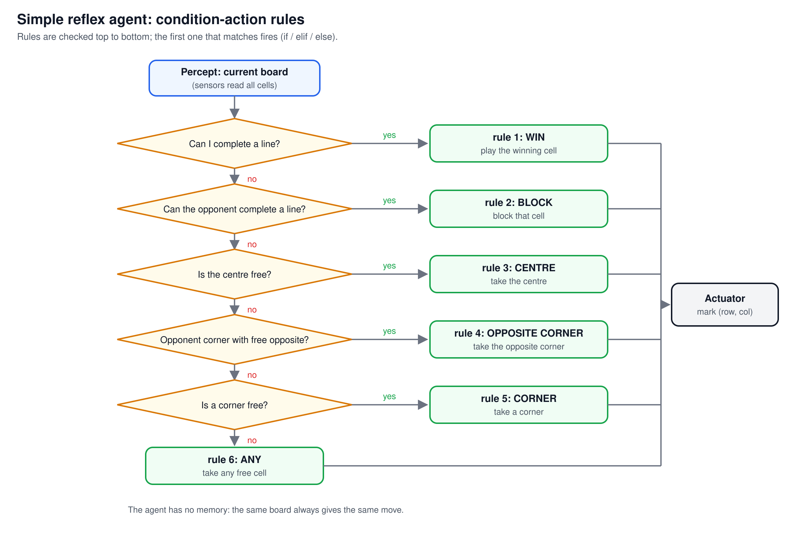
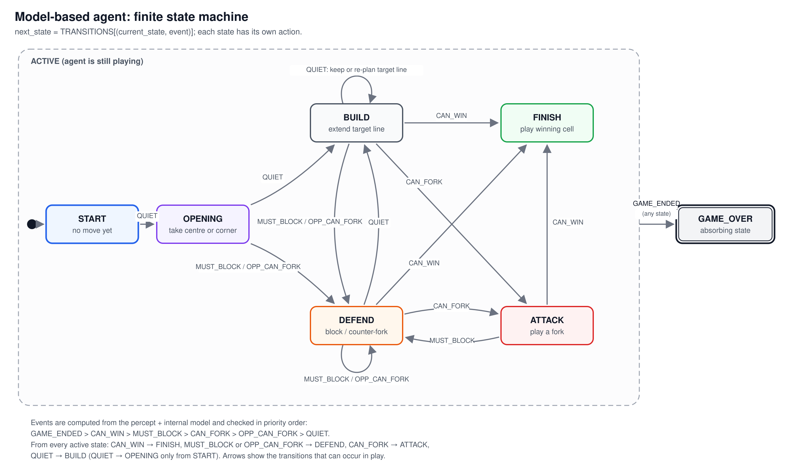
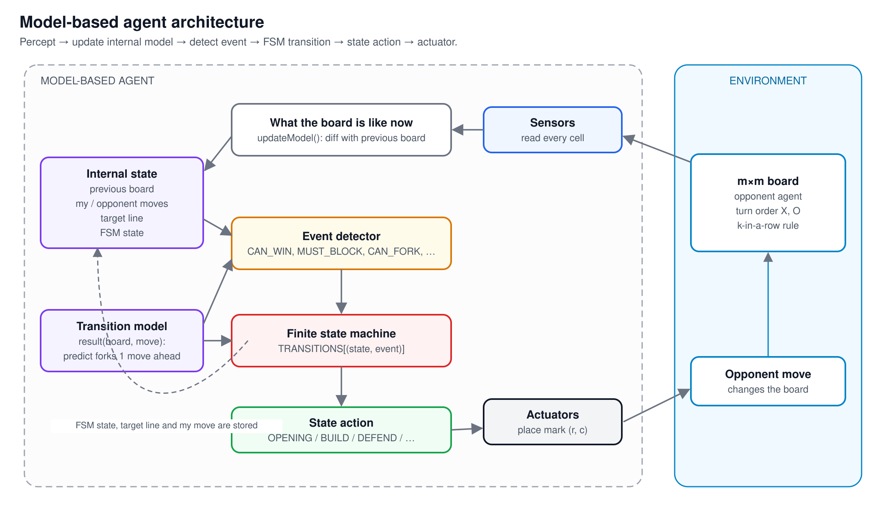

# Tic-Tac-Toe Agents

> ***Professor: Leyla Muradkhanli***    \
> ***Student: Huseyn Movla***         \
> ***Subject: Foundations of Artificial Intelligence***

Two agents that play generalised m×m tic-tac-toe (k marks in a row to win):

- a **simple reflex agent** built from if-else condition-action rules
- a **model-based agent** that keeps an internal model of the game and runs a finite state machine

The game engine is a Python port of my C++ tic-tac-toe engine ([hohseyuh/TTT](https://github.com/hohseyuh/TTT)).

## Files

| File | What it does |
|---|---|
| `game.py` | Board and rules: `initialState`, `player`, `actions`, `result`, `winner`, `terminal`, `utility` |
| `agents.py` | `RandomAgent`, `ReflexAgent`, `ModelBasedAgent`, `HumanAgent` |
| `main.py` | Demo, interactive play and agent-vs-agent matches |
| `test_agents.py` | Unit tests, including an exhaustive check that the model-based agent never loses on 3×3 |
| `diagrams.py` | Draws the diagrams in `diagrams/` as SVG |
| `report.docx` | Report: PEAS, environment types, agent design and results |

Requires Python 3.8+ and no dependencies.

## Usage

```bash
python main.py                                  # demo: scenarios, a full game with FSM trace, match results
python main.py play                             # you (X) against the model-based agent (O)
python main.py play --x model --o human         # the agent moves first
python main.py play --x reflex --o model -m 5 -k 4
python main.py match model reflex -n 200        # 200 games, sides swapped each game
python -m unittest -v                           # run the tests
python diagrams.py                              # redraw the diagrams
```

Agents: `human`, `random`, `reflex`, `model`. Moves are typed as `row col`, counted from 0.

## PEAS

| | |
|---|---|
| **Performance** | Win (+1), draw (0) or loss (−1); never losing; winning in as few moves as possible |
| **Environment** | m×m board, the k-in-a-row rule, an opponent (human or agent), alternating turns with X first |
| **Actuators** | Placing its mark in an empty cell `(row, col)` |
| **Sensors** | Reading the whole board: every cell is `X`, `O` or empty |

Environment types: fully observable, deterministic, sequential, static, discrete, multi-agent (competitive),
known.

## The agents

### Simple reflex agent

It looks only at the current board and fires the first rule that matches:

1. If I can complete a line, win.
2. Else if the opponent can complete a line, block it.
3. Else if the centre is free, take it.
4. Else if the opponent holds a corner whose opposite corner is free, take that corner.
5. Else if a corner is free, take it.
6. Else take any free cell.



### Model-based agent

The agent remembers the board it left after its own move, so it can work out the opponent's move. It also
keeps the history of both players' moves, a target line it keeps building across turns, and its current FSM
state. It uses the transition model `result(board, move)` to look one move ahead for forks.

On each turn it:

1. updates its model from the percept
2. detects the highest-priority event: `GAME_ENDED`, `CAN_WIN`, `MUST_BLOCK`, `CAN_FORK`, `OPP_CAN_FORK`,
   `QUIET`
3. moves to `TRANSITIONS[(state, event)]`
4. performs the action of the new state

| State | Action |
|---|---|
| `START` | Initial state, no move yet |
| `OPENING` | Take the centre, or a corner if the centre is gone |
| `BUILD` | Extend the remembered target line, and pick a new one when the opponent blocks it |
| `ATTACK` | Play a fork: two threats at once |
| `DEFEND` | Block a winning cell, or stop a fork by forcing the opponent to block |
| `FINISH` | Play the winning cell |
| `GAME_OVER` | Absorbing state once the game has ended |





## Results

The tests check every possible sequence of opponent moves on 3×3:

| Agent | As X: win / draw / loss | As O: win / draw / loss |
|---|---|---|
| Reflex | 119 / 26 / 0 | 404 / 175 / **6** |
| Model-based | 72 / 4 / **0** | 378 / 79 / **0** |

The reflex agent falls into the classic fork trap: X takes opposite corners, O takes the centre and then a
corner. The model-based agent spots the coming fork and forces a block instead.

Match results from the demo (200 games each on 3×3, 100 on 5×5 with 4 in a row, random agent seeded with 42):

| Match | Result |
|---|---|
| Reflex vs Random (3×3) | 178 wins, 21 draws, **1 loss** |
| Model-based vs Random (3×3) | 193 wins, 7 draws, 0 losses |
| Model-based vs Reflex (3×3) | 200 draws |
| Model-based vs Random (5×5, k=4) | 100 wins |
| Model-based vs Reflex (5×5, k=4) | 50 wins, 50 draws |
